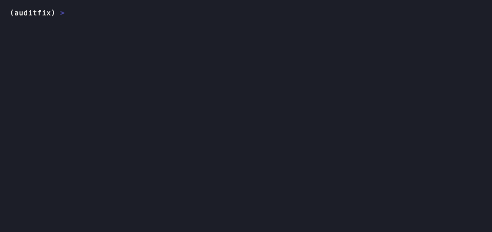

# auditfix

An agent that audits a database against a company policy, then proposes a SQL migration to fix what it found. Nothing is trusted until it has been checked: findings are checked against the policy text, and migrations are checked in a sandbox before anyone sees them.

Everything here is invented: the database (`alice@example.test`, SSNs like `000-00-0001`), the policy (six clauses, `POL-1.1` to `POL-3.2`) and the company. Only schema text and these fake rows ever reach the LLM.

## Demo



The sandbox gate, with no LLM and no network: `python -m examples.sandbox_demo`. It runs five migrations against invented demo databases. One passes. Four are refused, each with a readable reason, and the real database is never written to. This is the real code the pipeline uses to check what the engineer model writes.

## Example job

`POST /jobs` returns 202 with a `job_id`. `GET /jobs/{id}` returns the job. This is abridged output from a run in demo mode (`AUDITFIX_LLM=demo`), where the models are scripted stand-ins, so the single finding and the placeholder migration only show the shape of the response, not what the real models write:

```json
{
  "status": "done",
  "error": null,
  "grounding": {"ok": true, "judge": {"usable": true, "verdicts": [{"clause_id": "POL-1.1", "verdict": "supported", "...": "..."}]}},
  "migration": {
    "outcome": "verified",
    "attempts": 1,
    "sql": "CREATE TABLE IF NOT EXISTS audit_demo_note (id INTEGER PRIMARY KEY);",
    "unfixable": [],
    "recheck": {"...": "..."},
    "history": ["..."]
  },
  "trace": [
    {"kind": "model", "...": "..."}, {"kind": "tool", "name": "read_db_schema", "...": "..."},
    {"kind": "node", "name": "auditor", "...": "..."}, {"kind": "node", "name": "engineer", "...": "..."},
    {"kind": "node", "name": "sandbox", "...": "..."}
  ]
}
```

With a live key, `migration.sql` holds the model's migration only if it passed the sandbox and the recheck, and `migration.unfixable` lists the findings it declined, each with a reason.

### Real live runs

[`examples/live_runs.json`](examples/live_runs.json) has four real runs on the clean demo database (Groq: `gpt-oss-20b` writes, `gpt-oss-120b` judges), run once each on 2026-11-12:

| Run | Status | Findings supported | Attempts | Declined as not fixable in SQL |
| --- | --- | --- | --- | --- |
| 1 | `needs_review` | 1 (POL-1.1) | 1 | POL-1.1 |
| 2 | `done` | 6 | 3 | POL-1.1, 1.2, 2.2, 3.1 |
| 3 | `done` | 6 | 1 | POL-1.1, 1.2, 2.2, 3.1, 3.2 |
| 4 | `done` | 6 | 1 | POL-1.1, 1.2, 3.1 |

The real database file was byte-identical after every run. Four runs is not a success rate, and the file holds the full result of run 2 only.

- **Run 1** shows the auditor varying: it found only the plaintext password column, and the engineer correctly declined it, because SQLite cannot hash passwords. A human has to fix that in application code.
- **Run 2** shows the retry loop. Attempt 1 failed the recheck (POL-2.2 still unresolved). Attempt 2 failed the sandbox (`CHECK constraint failed`, which would have rejected existing rows). Attempt 3 passed both and added a foreign key to `access_log`.
- **Run 4 shows a weakness.** It "fixed" POL-2.2 by changing `at TEXT` to `at DATETIME`. In SQLite that is only a type name and changes nothing about the stored values, yet the judge counted it as resolved.

## What it does

1. **Auditor.** An agent loop with two tools, `read_db_schema` (read-only) and `read_policy`, writes a report that cites policy clauses like `[POL-2.1]`.
2. **Grounding.** A deterministic check rejects the report if it cites no clause, cites a clause that does not exist, or cites outside standards (GDPR, PCI-DSS, HIPAA, SOX, ISO 27001, NIST). Then a judge model reads each finding against the clause it cites and marks it supported or rejected.
3. **Engineer.** A model writes a SQLite migration for the supported findings. It may decline a finding it cannot fix in SQL, with a reason.
4. **Sandbox.** The migration runs on a copy of the target database. It fails if it loses rows, drops a table, leaves foreign key violations, touches ATTACH or PRAGMAs, or runs past a timeout.
5. **Recheck.** The judge confirms each fixable finding is resolved in the new schema.
6. **Retry.** If any step fails, the error goes back to the engineer. Three attempts at most.

The real database is never written to. A migration is only returned as a proposal.

## Job statuses

| Status | Meaning |
| --- | --- |
| `done` | A migration passed the sandbox and the recheck. Declined findings are listed in `migration.unfixable`. |
| `needs_review` | The job finished but nothing is trusted: the report failed grounding, the engineer gave up, every finding was declined, or three attempts failed. A human decides. |
| `failed` | An exception, or the process restarted mid-job. |

## Architecture

```
POST /jobs ──> 202 + job_id        GET /jobs/{id} ──> status, result, grounding, migration, trace
     │
     ▼
asyncio task ──> LangGraph
                    │
                    ▼
              ┌──────────┐  untrusted / no findings
              │ auditor  │───────────────────────────────> needs_review
              └────┬─────┘
                   │ supported findings
                   ▼
              ┌──────────┐  declined all ─────────────────> needs_review
              │ engineer │<──────────┐
              └────┬─────┘           │ error fed back,
                   │ SQL             │ max 3 attempts
                   ▼                 │
              ┌──────────┐  fail     │
              │ sandbox  │───────────┘
              │ + recheck│
              └────┬─────┘
                   │ pass
                   ▼
                  done
```

The routers only read state. Nodes return whole values. Each node writes one timed event to the job's trace, next to the model and tool events from the agent loop.

## Run it

```
uv venv --python 3.12 && source .venv/bin/activate
uv pip install -e ".[dev]"
pytest                                      # 176 tests, no network, ~4s
```

Demo mode needs no key. It uses scripted clients:

```
python -m app.demo_data target.db           # default demo DB
uvicorn app.main:app
curl -X POST localhost:8000/jobs
curl localhost:8000/jobs/<job_id>
```

Live mode uses Groq. Put `GROQ_API_KEY=...` in `.env` (gitignored):

```
python -m app.demo_data clean.db --clean
AUDITFIX_LLM=groq AUDITFIX_TARGET_DB=clean.db uvicorn app.main:app --env-file .env
```

Two demo databases, on purpose:

- **Default.** `access_log` has one row for a user that does not exist. Adding a foreign key would break it, so the sandbox refuses. This is the safe-failure case.
- **`--clean`.** No orphan row. The foreign key rebuild can pass.

## Choices and trade-offs

- **asyncio tasks, not Celery.** The job is saved before the task starts, and the API returns 202 with a status URL. That is enough for one process. Celery earns its place when jobs must survive restarts or run on several workers. Jobs that were running at a restart are marked `failed: interrupted by restart`, not resumed.
- **SQLite, not Postgres.** Same reasoning: one process, one file. Multiple workers would need Postgres.
- **LangGraph.** The flow has a loop with a cap and several exit states. A graph makes those explicit, and the recursion limit sits beneath the attempt cap as a backstop.
- **Allowlist, then judge.** The cheap deterministic check runs first and the judge only sees reports that pass it. The judge cannot be argued out of the allowlist.
- **The writer never grades itself.** The engineer is `gpt-oss-20b`; the judge and recheck are `gpt-oss-120b`.
- **Per-finding gate.** One rejected finding does not throw away the rest. Rejected ones are listed, supported ones go on.
- **Fail closed.** A judge crash, a skipped clause or a missing verdict means untrusted, not trusted.
- **`reasoning_effort="low"` for the engineer.** With full reasoning, `gpt-oss-20b` failed Groq's JSON mode (`json_validate_failed`) 3 of 3 times. With low effort it worked 3 of 3. Small sample, but the gap was complete.

## Known limits

- **Few runs.** Four live runs on the clean demo DB: three reached `done`, one ended `needs_review`. That is too few to give a rate, and it is one small database. On the default DB the foreign key was refused, as intended.
- **The judge accepts cosmetic fixes.** See run 4 above: a type rename that changes nothing was marked resolved.
- **The engineer over-declines.** It declined findings like POL-3.1 and POL-2.2 as not fixable in SQL, and nothing checks those declines.
- **The sandbox counts rows, not contents.** A migration that drops a plaintext column passes the gate even though it destroys that data. A column-level check is not built.
- **The judge is imperfect and varies.** It caught a stretched citation (POL-2.2 used for "no primary key") but accepted POL-3.2 in one run and rejected it in others. On a public benchmark it accepted 6 of 42 unsupported claims (see Evals below).
- **Prompt injection is reduced, not solved.** Text from the schema, report and findings is stripped of the tags the prompts use as delimiters. A determined payload in a column name could still try.
- **Single process.** See the Celery and Postgres notes above.
- **Groq free tier.** Rate limits (429) and intermittent `output_parse_failed` 400s happen. Both are retried with backoff.

## Evals

- **Unit tests:** 189, no network. They check the code with scripted clients, not model quality.
- **Judge accuracy, public benchmark:** `python -m evals.aggrefact --n 100 --model <groq model>` runs a judge on a seeded sample of [LLM-AggreFact](https://huggingface.co/datasets/lytang/LLM-AggreFact) (gated, loaded at run time, not stored here). Each row is a document, a claim, and a label for whether the document supports the claim.
  - **Results, same 100 rows for both models, no judge errors:**

    | Judge | Accuracy | Accepted an unsupported claim | Rejected a supported claim |
    | --- | --- | --- | --- |
    | `gpt-oss-120b` (this pipeline's judge) | 86% (78 to 91) | 6 of 42, 14% (7 to 28) | 8 of 58, 14% (7 to 25) |
    | `qwen3.8-27b` | 81% (72 to 87) | 6 of 42, 14% (7 to 28) | 13 of 58, 22% (14 to 35) |

    Intervals are 95%. They overlap heavily, so these runs do not show that one model is better. Both accepted about one unsupported claim in seven, which is the dangerous error. That is why a judge verdict is never the only gate here: citations are checked against an allowlist first, and a migration must also pass the sandbox.
  - **How far to trust the numbers:** 100 rows is small, and the intervals are wide. Only documents under 3,000 characters are sampled, so results are biased toward short documents. The sample is balanced across the benchmark's 11 sources, with about 11 rows each, so the per-source numbers are too small to read. It uses a generic grounding prompt, not the policy-specific one, so it measures the model as a fact-checker, not this pipeline's judge on this policy.
- **Not built:** a hand-labelled set on this project's own policy, and enough repeated engineer runs to give a real verified rate (there are four so far).

## Next

- A judge check on the engineer's declines.
- A column-content check in the sandbox.
- A hand-labelled eval set on this policy, which is what would measure the judge on this task.
- Record `finish_reason` in the trace.

## Layout

```
app/main.py        FastAPI: POST /jobs, GET /jobs/{id}
app/runner.py      wires models, runs the graph, saves the job
app/graph.py       LangGraph: auditor -> engineer -> sandbox
app/agent/         agent loop, Groq client, demo client
app/tools/         read_db_schema, read_policy, registry
app/policy/        policy.json, citation grounding
app/judge.py       judge and JSON client
app/engineer.py    migration drafting
app/recheck.py     judge re-check of the new schema
app/sandbox.py     copy, apply, verify, delete
examples/          offline sandbox demo (python -m examples.sandbox_demo)
evals/             judge eval on LLM-AggreFact
assets/            demo GIF and the vhs tape that made it
app/store.py       SQLite jobs and trace
tests/             176 tests
```
